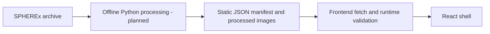

# Phase 1 architecture

This page summarizes the design. For implementation details, see [the codebase walkthrough](CODEBASE.md); for local tooling and hosting status, see [the infrastructure guide](INFRASTRUCTURE.md).

Only the empty manifest, loader and shell are implemented. The planned producer appears to explain the integration boundary.

## Responsibilities

- Artem's future Python pipeline acquires products, checks quality, aligns images and exports documented spectral selections, rendering choices and provenance.
- Static assets are public browser images and metadata. Raw FITS is not a frontend input.
- The contract is a cross-language agreement reviewed by Ryan, Artem and Niyati; TypeScript represents the consumer's view.
- Ryan's loader checks HTTP success, schema version, required fields, bounds, times and ordering. Malformed manifests fail explicitly.
- Theo's UI renders loading, error and empty states. A count acknowledges future ready records without implementing a viewer.
- Niyati validates scientific interpretation and comparability; Pranav documents actual capabilities and limitations.

## Decisions

| Choice | Reason and trade-off |
| --- | --- |
| One root-level Vite application | One install/build; no workspace or nested application configuration overhead |
| Offline processing and static delivery | Predictable demonstration without live service dependency; new data requires another build/publication |
| JSON boundary | Python and React can evolve independently; fetched data still needs runtime checks |
| Strict TypeScript and ESLint | Catch integration mistakes; no routing or global state framework needed |
| Plain CSS | Adequate for the shell; substantial UI remains Theo's responsibility |

Backend/database and full-stack frameworks add operations without a Phase 1 responsibility.
Browser FITS processing would put scientific work and large downloads in the presentation layer.
A shared npm package would add maintenance for a single JavaScript consumer.

The manifest URL uses Vite's base URL. Future viewers must resolve image paths against the manifest directory.
Broken image requests must become explicit errors when image display is implemented.

## Constraints and conscious debt

Runtime validation checks shape, not scientific truth. A ready record is a producer claim; it cannot prove calibration, alignment or authentic provenance.
Comparison groups must document a reviewed common grid and rendering method. Equal dimensions or wavelength bounds alone do not establish comparability.
Visible changes may be instrumental or processing artifacts; a timelapse does not establish a Planet X detection.

The provisional contract needs Artem and Niyati's approval. Keep the hand-written validator, types and contract synchronized.
Whole-manifest rejection favors clear failures over partial recovery; revisit if the curated dataset grows.
No live integration, pipeline, viewer, difference-image contract, CI, Docker or deployment is implemented.
