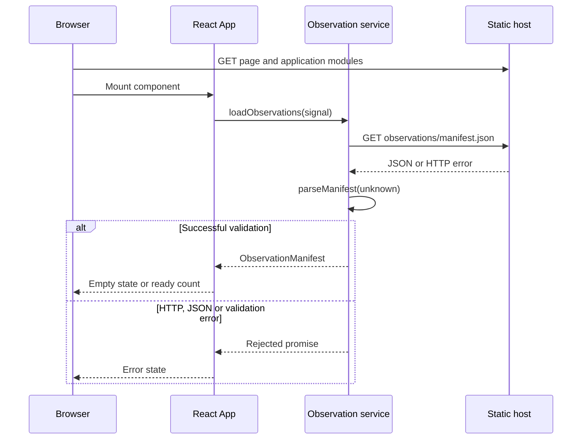

# Current codebase walkthrough

This guide explains the implemented Phase 1 foundation. Read [the architecture overview](ARCHITECTURE.md) for the design rationale and [the data contract](DATA_CONTRACT.md) for exact field semantics.

## 1. What the application currently does

The application identifies SPHEREx Motion Explorer, requests a local static JSON manifest, validates that JSON, and renders a loading, error or loaded state. The supplied manifest has no targets, so successful loading produces an honest empty state.

If a future valid manifest contains ready observations, the shell displays their count. It does not display their images or provide a target picker. Coordinate search, playback, differencing, archive acquisition and scientific processing are not implemented.

The application has one screen. Its state is local to one React component; there is no router, global state store or backend.

## 2. Repository map

```text
.
├── index.html
├── package.json / package-lock.json
├── vite.config.ts
├── tsconfig.json / tsconfig.node.json
├── eslint.config.js
├── .nvmrc / .gitignore / .gitattributes
├── README.md
├── AGENTS.md / CLAUDE.md
├── src/
│   ├── main.tsx
│   ├── App.tsx
│   ├── styles.css
│   ├── types/observations.ts
│   └── services/observations.ts
├── public/observations/manifest.json
├── processing/README.md
└── docs/
    ├── ARCHITECTURE.md
    ├── CODEBASE.md
    ├── INFRASTRUCTURE.md
    └── DATA_CONTRACT.md
```

Local generated directories such as node_modules/, dist/ and .tools/ are deliberately excluded from this map. See [infrastructure](INFRASTRUCTURE.md) for their roles.

## 3. Follow one page load



The browser does not contact a NASA archive. The only application data request is for a file hosted alongside the frontend.

## 4. Entry point: index.html and src/main.tsx

index.html provides the page title, metadata and a root element. Its module script points to src/main.tsx during development; Vite rewrites the entry to bundled assets for production.

main.tsx imports the global stylesheet, creates the React root and renders App inside StrictMode. This file connects React to the DOM; it contains no astronomical logic.

StrictMode enables development checks, including an extra effect setup/cleanup cycle. Seeing an aborted initial manifest request during development can be consistent with this behavior. The effect's cleanup is therefore meaningful, rather than merely preparation for a future screen.

## 5. UI state: src/App.tsx

LoadState is a discriminated union: the status field selects one of three allowed shapes.

| Status | Data available | UI behavior |
| --- | --- | --- |
| loading | No manifest yet | Loading message |
| loaded | A validated manifest | Empty state or total ready-observation count |
| error | No usable manifest | Failure message suggesting reload |

Only the loaded shape carries a manifest, making accidental use before loading a TypeScript error. This avoids separate booleans such as isLoading and hasError that could describe contradictory states.

A useEffect starts one load for the mounted component. It creates an AbortController and passes its signal to the loader. Cleanup aborts the request; an abort does not intentionally become an error message. The effect is not a polling loop or archive synchronization mechanism.

readyCount is derived from the manifest instead of stored in another state variable. This keeps the count consistent with its source. The count covers all targets; no target is selected yet.

The page uses semantic main/header/section/footer elements. The status region uses aria-live="polite" so assistive technology can announce updates. src/styles.css provides a small global layout and color palette for Theo to evolve.

Errors are intentionally simplified in the UI. The loader creates specific messages, but App currently discards those details. There is no retry button, error telemetry or error reporting service; reload is the available retry.

## 6. Data model: src/types/observations.ts

The file describes our application contract, not an IRSA response.

| Type | Responsibility |
| --- | --- |
| ObservationManifest | Versioned root containing targets |
| Target | Identity, ICRS coordinates and observation records |
| Observation | A ready record or a record excluded with a reason |
| Provenance | Dataset/product identifiers and source reference |
| SpectralSelection | Description and wavelength bounds in micrometers |
| Processing | Processing explanation, revision and comparison group |

Observation is another discriminated union. Checking status === 'ready' gives the caller a non-null timestamp, imagePath and processing/spectral metadata. Excluded records use unavailable or incompatible and carry a reason instead.

This models the distinction between an observation we can display and one we know about but should exclude. It does not prove that a ready record has been scientifically reviewed.

Types disappear from the browser's executable JavaScript. Declaring that a fetch result has a TypeScript type would not check its contents.

## 7. Runtime boundary: src/services/observations.ts

The file has two exported functions with separate responsibilities:

- loadObservations(signal?) performs the fetch using Vite's BASE_URL, checks HTTP success, parses JSON and calls the validator.
- parseManifest(value) accepts unknown data and either returns an ObservationManifest or throws an Error.

Small private helpers check objects, nonempty strings, finite numbers and canonical UTC timestamps. Timestamp validation includes an ISO round-trip so impossible calendar dates are rejected rather than accepted after normalization.

The validator checks version, coordinate bounds, identifiers, required arrays, timestamp ordering, source metadata, allowed image paths and status-specific fields. Known times must be chronological, with IDs breaking ties; unknown times belong last. Ready records need a timestamp and at least one provenance item.

Each target has its own set of observation IDs. Target IDs are unique across the manifest. Additional fields are tolerated, allowing additive metadata without immediately breaking the consumer.

The validator rejects the whole manifest if any record fails. It does not repair, sort or silently remove bad records. That makes a small curated dataset's errors visible, at the cost of preventing partial recovery.

The final type assertion is justified by the preceding runtime checks. When the contract changes, update the Markdown agreement, TypeScript declarations and checks together.

Limitations: the service checks source URL syntax, not whether the URL exists or identifies authentic NASA data. It checks image-path syntax, not whether the file exists. It does not fetch images, verify pixels, calibrate flux, align images or assess scientific comparability.

## 8. Static assets and future processing

public/observations/manifest.json currently contains schemaVersion 1 and an empty targets array. It is copied into the production output and served as a file, rather than imported into a TypeScript module.

Future imagePath values are relative to the manifest's directory. A later viewer must resolve those paths accordingly; the current shell does not yet contain an image URL resolver.

processing/README.md reserves a useful ownership boundary for Artem. It is documentation, not an executable Python project. There are no Python requirements, acquisition scripts or sample FITS products in the foundation.

## 9. Where to make a change

| Change | Main files / coordination |
| --- | --- |
| Layout, wording or presentation | App.tsx and styles.css; Theo |
| Manifest request/error behavior | services/observations.ts and App.tsx; Ryan |
| New or changed metadata | DATA_CONTRACT.md, types and validator; Ryan, Artem and Niyati |
| Real processed exports | public/observations/; Artem with scientific review |
| Scientific processing | Future work under processing/; approved separately |
| Build/tooling | Root configuration; Ryan |

Read in this order: data contract → types → service → App → main → infrastructure guide. This follows the boundary between producer and consumer before looking at the UI wiring.
